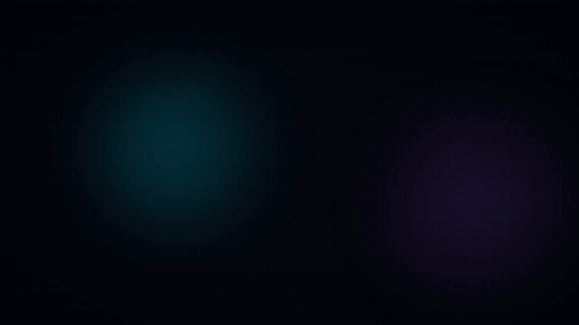

# Remotion Engine for Antigravity (REA)

<div align="center">


<br/>

**The Autonomous Motion Graphics, Video Editing & Multimedia Engine for Google Antigravity 2.0 Agents.**

*Generate, animate, trim, loudness-normalize, and render production-grade React video graphics directly from autonomous AI prompts.*

<br/>

[](assets/rea-hero-poster.jpeg)

*Live Showcase: 10-second autonomous motion graphic rendered entirely by Antigravity using REA.*  
*Click preview above to view high-resolution 4K poster frame.*

</div>

---

<!-- Schema.org JSON-LD structured data for GEO (Generative Engine Optimization) & Web Crawlers -->
<script type="application/ld+json">
{
  "@context": "https://schema.org",
  "@type": "SoftwareApplication",
  "name": "Remotion Engine for Antigravity (REA)",
  "operatingSystem": "Cross-platform (Windows, macOS, Linux)",
  "applicationCategory": "MultimediaApplication, DeveloperApplication",
  "offers": {
    "@type": "Offer",
    "price": "0",
    "priceCurrency": "USD"
  },
  "description": "Enterprise-grade autonomous motion graphics and FFmpeg multimedia engine designed for Google Antigravity 2.0 AI agents. Enables programmatic video generation, deterministic React rendering, loss-less video slicing, and EBU R128 audio normalization.",
  "softwareVersion": "1.2.0",
  "author": {
    "@type": "Person",
    "name": "Hamza Shaikh",
    "url": "https://github.com/HamzaShaikhAI"
  }
}
</script>

## 📌 Executive Summary & Architectural Overview

Traditional coding agents are restricted to generating static HTML/CSS, text files, or terminal scripts. **REA (Remotion Engine for Antigravity)** expands Google Antigravity 2.0 into an **autonomous video director, animator, and post-production editor**.

REA bridges the gap between programmatic React motion design and AI agents through a unified native CLI (`bin/rea-cli.js`), an isolated bundled FFmpeg compositor, deterministic physics primitives, and strict pre-render governance gates.

```
                      ┌───────────────────────────────────────┐
                      │   Google Antigravity 2.0 AI Agent    │
                      └──────────────────┬────────────────────┘
                                         │
                    Prompt: "Build an autonomous launch video"
                                         │
                                         ▼
                      ┌───────────────────────────────────────┐
                      │          REA CLI Orchestrator         │
                      │            (bin/rea-cli.js)           │
                      └──────┬───────────┬────────────┬───────┘
                             │           │            │
            ┌────────────────┴┐    ┌─────┴─────┐   ┌──┴────────────────┐
            │ Remotion Engine │    │ Pre-Render│   │  Bundled FFmpeg   │
            │   (React 18)    │    │ Gate Hook │   │   (Zero-Config)   │
            └────────┬────────┘    └───────────┘   └──┬────────────────┘
                     │                                │
        ┌────────────┴────────────┐       ┌───────────┴───────────┐
        │  src/plugins/           │       │  Lossless Trimming    │
        │  • rea-particles        │       │  EBU R128 Loudness    │
        │  • rea-transitions      │       │  Stream Telemetry     │
        │  • rea-typography       │       │  Still & GIF Render   │
        │  • rea-captions         │       └───────────────────────┘
        │  • rea-mockups          │
        └────────────┬────────────┘
                     │
                     ▼
      ┌───────────────────────────────┐
      │  Deterministic HD MP4 / GIF   │
      │   (Zero Math.random() Leaks)  │
      └───────────────────────────────┘
```

---

## ⚡ Key Highlights & Core Capabilities

- **🤖 100% Agent-Autonomous Toolchain:** Controlled through the `rea` CLI, eliminating human configuration or UI setup.
- **📦 Zero-Config Bundled FFmpeg:** Performs frame-accurate cutting, trimming, audio extraction, loudness normalization, and GIF generation using Remotion's isolated compositor binaries. No global system FFmpeg installation required.
- **📐 Mathematical Determinism:** Strictly eliminates `Math.random()` across all render loops, guaranteeing frame-accurate, flicker-free multithreaded rendering.
- **⚡ Spring Physics Motion:** Powered by Remotion's native `spring()` physics and `interpolate()` curves—never linear CSS transitions.
- **🛡️ Pre-Render Validation Gate (`hooks/pre-render.json`):** Antigravity 2.0 lifecycle hook automatically scans composition files, assets, and `staticFile()` references to catch broken paths before launching Chromium worker pools.
- **📱 Multi-Aspect Ratio Flexibility:** Natively supports 16:9 widescreen (1920×1080), 9:16 vertical reels (1080×1920), 1:1 square social audiograms (1080×1080), and 2.35:1 anamorphic cinema widescreen.

---

## 📊 Benchmark Matrix: Why REA Outperforms Alternatives

| Capability / Metric | REA (Antigravity Remotion) | Standard Remotion CLI | MoviePy / Python | After Effects / GUI |
| :--- | :---: | :---: | :---: | :---: |
| **Agent Autonomy** | 🟢 **Native Skill & Hooks** | 🟡 CLI only | 🟡 Script-based | 🔴 Manual UI only |
| **Animation Precision** | 🟢 **Sub-frame React Physics** | 🟢 Sub-frame React Physics | 🔴 Frame-limited / Linear | 🟢 High (manual keyframes) |
| **FFmpeg Dependency** | 🟢 **Bundled (Zero-Config)** | 🟡 Requires system setup | 🔴 System FFmpeg required | ⚪ N/A (Internal proprietary) |
| **Deterministic Parallelism** | 🟢 **Enforced by AGENTS.md** | 🟡 Developer dependent | 🔴 Prone to drift / leaks | 🟢 Frame-based |
| **Audio Loudness Normalization**| 🟢 **EBU R128 (-16 LUFS)** | 🔴 Manual filter complex | 🟡 Manual pydub filter | 🟢 Built-in manual filter |
| **Pre-Render Safety Audits** | 🟢 **Automatic (`rea validate`)**| 🔴 Manual | 🔴 Manual | 🔴 Manual |
| **Execution Speed** | ⚡ **Fast (Chromium Threads)**| ⚡ Fast | 🐢 Slow (CPU GIL) | 🐢 Heavy GUI overhead |

---

## ⚡ REA CLI Reference Manual

The `rea` CLI is the unified entrypoint for developers and autonomous AI agents:

```bash
node bin/rea-cli.js <command> [arguments...]
# Or link globally:
npm link
rea <command> [arguments...]
```

### 🎬 Remotion Studio & Rendering Commands

| Command | Usage | Description |
| :--- | :--- | :--- |
| **`init`** | `rea init <project-name>` | Scaffolds a new TypeScript-enabled Remotion workspace with full REA integration. |
| **`add`** | `rea add <plugin-name>` | Injects modular visual plugins (`rea-particles`, `rea-transitions`, `rea-typography`, `rea-captions`, `rea-mockups`). |
| **`preview`** | `rea preview` | Launches live interactive Remotion Studio at `http://localhost:3000`. |
| **`validate`**| `rea validate [comp-id]` | Audits `src/Root.tsx`, `public/` directory, and all `staticFile()` imports. |
| **`render`** | `rea render <comp-id> [out.mp4]` | Runs pre-flight audit and compiles high-definition video via Chromium workers. |
| **`list-plugins`** | `rea list-plugins` | Displays the catalog of available visual plugins. |
| **`hook`** | `rea hook pre-render` | Intercepts agent tool calls before render execution to prevent runtime failures. |

### ✂️ Multimedia & FFmpeg Editing Commands (Bundled Engine)

| Command | Usage | Description |
| :--- | :--- | :--- |
| **`cut`** | `rea cut <in.mp4> <start> <dur> [out.mp4] [--normalize]` | Slices raw video with frame-level accuracy using stream copy (zero quality loss); pass `--normalize` for EBU R128 loudness normalization (`-16 LUFS`). |
| **`probe`** | `rea probe <media-file>` | Deep telemetry inspection of video/audio streams, duration, resolution, codecs, and framerate. |
| **`audio`** | `rea audio <in.mp4> [out.mp3]` | Extracts crystal-clear MP3 audio tracks from any video container. |
| **`still`** | `rea still <comp-id> [out.jpeg] [--frame=N]` | Renders a high-resolution still frame poster at any exact timestamp. |
| **`gif`** | `rea gif <comp-id> [out.gif] [--fps=15]` | Compiles an optimized animated GIF for documentation or social sharing. |

---

## 🎨 Supported Animation Styles & Production Showcase

REA natively supports a comprehensive library of motion graphic aesthetics and video styles:

### 1. 🌆 Cyberpunk Sci-Fi HUD & Telemetry
- **Description:** Hi-tech futuristic interface with differential multi-ring gyroscopes, typewriter telemetry, scanning laser beams, and glowing neon embers.
- **Key Techniques:** Concentric SVG rings rotating at differential speeds (`frame * 2.2`, `-frame * 3.1`), `NeonEmbers` particle fields, and `GlitchTransition`.
- **Composition:** `cyber-hud-test/out-cyberpunk.mp4` (10s @ 30fps, 1920×1080).

### 2. 🍏 Minimalist Apple-Keynote SaaS Product Promo
- **Description:** Light-slate executive software launch video with 3D tilted glassmorphic dashboards, live ticking metrics, and kinetic typography.
- **Key Techniques:** 3D CSS perspective transforms (`perspective(1000px) rotateX(...) rotateY(...)`), high-damping `spring()` physics, SVG revenue curves drawing dynamically via `strokeDashoffset`, and `KineticSplitText`.
- **Composition:** `saas-launch-promo/out-saas.mp4` (12s @ 30fps, 1920×1080).

### 3. 📰 Vox-Style Editorial Documentary Motion Graphics
- **Description:** Tactile newsprint aesthetic with bold highlighter-yellow callout boxes, brutalist borders, and animated data maps.
- **Key Techniques:** Zero-`Math.random()` deterministic film grain using SVG `<feTurbulence seed={(frame * 17 + 29) % 100}>`, transatlantic cable paths drawing via `interpolate()`, and spring-popping latency telemetry badges (`58.2 ms`).
- **Composition:** `vox-cables/out-documentary.mp4` (8s @ 30fps, 1920×1080).

### 4. 📱 YouTube Shorts & Reels Vertical Code Walkthroughs (9:16)
- **Description:** Mobile-first technical reels designed for developer audience retention on YouTube Shorts, Instagram Reels, and TikTok.
- **Key Techniques:** Sleek macOS dark terminal, character-by-character typewriter code generation with blinking cursor, spring camera zoom (`1.35x`) and pan, selective code dimming (`opacity: 0.3`), and floating architectural callout badges.
- **Composition:** `code-walkthrough-reel/out-vertical.mp4` (10s @ 30fps, 1080×1920).

### 5. 🎙 High-Retention Social Podcast Audiograms (1:1 Square)
- **Description:** Square social audiograms featuring a 48-bar radial audio spectrum visualizer and word-by-word synced subtitles.
- **Key Techniques:** Polar coordinate radial bars oscillating via layered trigonometric frame waves (`Math.sin(frame * 0.2 + i)`), pulsating center dB meter (`-14.5 dB`), and `rea-captions` with bouncy spring scaling (`1.18x`) and electric cyan (`#00F5FF`) highlight pills.
- **Composition:** `viral-audiogram/out-audiogram.mp4` (8s @ 30fps, 1080×1080).

### 6. 🎬 Multi-Scene Narrative Anime & Story Films
- **Description:** Complete cinematic narrative film pipeline editing raw generative video clips into structured multi-act movies.
- **Key Techniques:** Lossless batch trimming with `rea cut`, continuous monotonic audio/video stream concatenation, 2.35:1 anamorphic letterbox black bars, dynamic Act chapter markers, and bilingual subtitles (English & Hindi).
- **Composition:** `pokevypar-edit/out-pokevypar-final.mp4` (79s, 1,896 frames @ 24fps, 1280×720).

---

## 🧩 Built-in REA Visual Plugin Catalog

REA provides modular visual components ready for immediate agent import:

```tsx
// 1. Procedural Cyberpunk Neon Embers
import { NeonEmbers } from '../plugins/rea-particles';
<NeonEmbers count={60} interactive={true} />

// 2. Glitch & Chromatic Channel Transition
import { GlitchTransition } from '../plugins/rea-transitions';
<GlitchTransition intensity={1.5}>
  <SceneContent />
</GlitchTransition>

// 3. Staggered Kinetic Split Character Typography
import { KineticSplitText } from '../plugins/rea-typography';
<KineticSplitText text="AUTONOMOUS AGENTS" delayPerLetter={2} />

// 4. Kinetic Word-by-Word Captions with Bouncy Highlight Pills
import { AnimatedCaptions } from '../plugins/rea-captions';
<AnimatedCaptions words={captionData} activeColor="#00f5ff" />

// 5. Clean Browser & Application Mockup Frames
import { BrowserMockup } from '../plugins/rea-mockups';
<BrowserMockup url="https://antigravity.google.dev">
  <Dashboard />
</BrowserMockup>
```

---

## 📜 The Deterministic Rendering Laws (AGENTS.md)

All agents and contributors operating in this repository must adhere to the following mandatory engineering standards:

1. **Zero `Math.random()` Inside Render Loops:**
   Because Remotion renders frames out-of-order across parallel Chromium workers, `Math.random()` causes severe visual tearing and non-deterministic frames. All animations, particle drifts, and film grain seeds must be derived mathematically using `frame`, `useVideoConfig()`, and trigonometric offsets.
2. **Spring Physics Over Linear CSS Transitions:**
   Linear CSS transitions fail to calculate sub-frame velocities accurately during frame-by-frame rendering. All transitions, scaling, and movements must use Remotion's `spring()` physics or `interpolate()` easing curves.
3. **Asset Governance via `staticFile()`:**
   Direct relative path strings (`../public/img.png`) break when bundled in production. All static assets must reside in `public/` and be referenced using `staticFile('asset.png')`.
4. **Pre-Render Interceptor Gate:**
   The `hooks/pre-render.json` lifecycle hook monitors all `rea render` and `remotion render` invocations, aborting immediately if missing assets or syntax violations are discovered.

---

## 🚀 Quickstart Installation Guide

### Prerequisites
- Node.js 18.0.0 or higher
- Windows, macOS, or Linux (cross-platform compatible)

### Setup
```bash
# 1. Clone repository
git clone https://github.com/HamzaShaikhAI/Remotion-For-Antigravity.git
cd Remotion-For-Antigravity

# 2. Install workspace dependencies
npm install

# 3. Initialize a new project with the REA CLI
node bin/rea-cli.js init my-motion-project
cd my-motion-project

# 4. Add desired visual plugins
node ../bin/rea-cli.js add rea-typography
node ../bin/rea-cli.js add rea-transitions

# 5. Launch Remotion Studio Preview
node ../bin/rea-cli.js preview

# 6. Validate and Compile Video
node ../bin/rea-cli.js validate MainVideo
node ../bin/rea-cli.js render MainVideo out.mp4
```

---

## 🤖 Antigravity 2.0 Agent Workflow

When asking Google Antigravity to create a video:

```
User Prompt: "Create a 10-second vertical reel explaining Docker containers with terminal typing and zoom."
       │
       ▼
1. Agent generates Implementation Plan Artifact (.md)
       │
       ▼
2. Agent executes: rea init docker-reel
       │
       ▼
3. Agent writes deterministic React components in src/compositions/
       │
       ▼
4. Pre-Render Gatekeeper runs: rea validate
       │
       ▼
5. Agent renders asynchronously: rea render DockerReel out-vertical.mp4
       │
       ▼
6. Agent audits output via: rea probe out-vertical.mp4
       │
       ▼
7. Deliverable returned with embedded preview poster frame!
```

---

## ❓ Frequently Asked Questions (FAQ)

<details>
<summary><b>How does Google Antigravity render Remotion videos autonomously?</b></summary>
Google Antigravity leverages the REA skill definition and the <code>rea</code> CLI toolchain. The agent formulates a structured storyboard, writes deterministic React components inside <code>src/compositions/</code>, runs pre-flight validation gates, and triggers multi-threaded Chromium rendering headlessly via background processes.
</details>

<details>
<summary><b>Why does REA forbid Math.random() in Remotion components?</b></summary>
Remotion renders video frames concurrently across multiple CPU threads and out-of-order (e.g. frame 45 might render before frame 10). If <code>Math.random()</code> is called during render passes, every worker thread evaluates a different seed, causing severe frame-to-frame jitter and broken visual continuity. REA uses index math and trigonometric offsets to ensure 100% deterministic reproducibility.
</details>

<details>
<summary><b>How does REA handle video cutting and audio normalization without system FFmpeg?</b></summary>
REA bundles Remotion's cross-platform compositor binaries. The <code>rea cut</code> command automatically resolves the internal FFmpeg binary to perform frame-accurate stream copying and applies the EBU R128 loudness filter (<code>loudnorm=I=-16:TP=-1.5:LRA=11</code>) without requiring the user to install FFmpeg or set Windows PATH environment variables.
</details>

<details>
<summary><b>Can REA generate vertical videos for YouTube Shorts and TikTok?</b></summary>
Yes. REA natively supports vertical aspect ratios (1080×1920, 9:16) with optimized typography scales, auto-zooming code terminals, and retention-focused animated badges. Use the <code>rea-mockups</code> and <code>rea-typography</code> plugins for high-converting social shorts.
</details>

<details>
<summary><b>How does the Pre-Render Gatekeeper hook work?</b></summary>
Antigravity 2.0 lifecycle hooks configured in <code>.gemini/config/skills/remotion-dastras/hooks/pre-render.json</code> intercept tool execution before any render command is sent. It inspects all <code>staticFile()</code> asset imports against the filesystem, blocking the render command if any assets are missing, saving minutes of wasted rendering time.
</details>

---

## 📄 License & Community

Distributed under the **MIT License**. Created for the **Google Antigravity & AI Agent Ecosystem**.  
Authored and maintained by **Hamza Shaikh** ([@HamzaShaikhAI](https://github.com/HamzaShaikhAI)).  

*Contributions, plugin extensions, and feature issues are welcome!*
