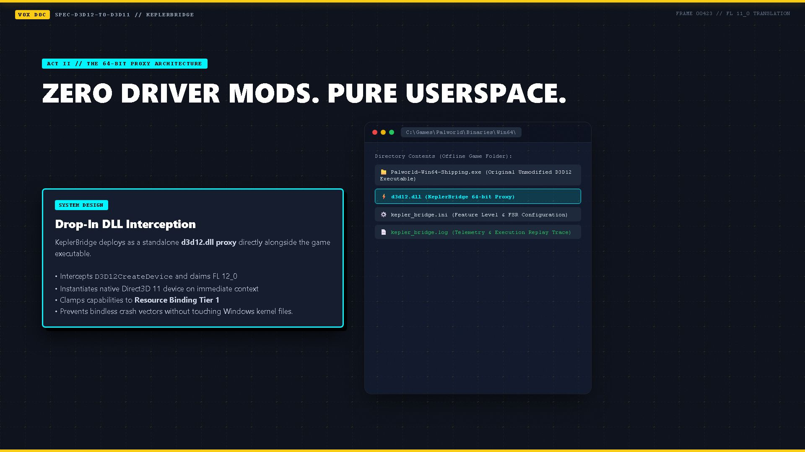

# Remotion Engine for Antigravity (REA)

<div align="center">


-00f5ff?style=for-the-badge&logo=github&logoColor=white)


<br/>

**The Autonomous Motion Graphics, Procedural Sound Synthesis, AI Voiceover & Multimedia Video Editing Engine for Google Antigravity 2.0 AI Agents.**

*Generate, animate, narrate, synthesize sound, trim, loudness-normalize, and render production-grade React videos directly from autonomous AI prompts.*

<br/>

| Flagship Hero Motion Showcase (10s @ 30fps) | KeplerBridge 6-Act Long-Form Documentary (139s @ 30fps) |
| :---: | :---: |
| [](assets/rea-hero-poster.jpeg) | [](assets/keplerbridge-doc-poster.jpeg) |
| *Click to view high-resolution 4K poster* | *Click to view 6-Act technical documentary poster* |

</div>

---

## 📑 Table of Contents

1. [Executive Summary & Architectural Overview](#-executive-summary--architectural-overview)
2. [Quick Start & Global Skill Installation](#-quick-start--global-skill-installation)
3. [Unified CLI Command Reference](#️-unified-cli-command-reference)
4. [Architectural Deep Dives](#-architectural-deep-dives)
   - [Dual-Provider AI Voiceover & Multi-Speaker Dialogue](#1-dual-provider-ai-voiceover--multi-speaker-dialogue)
   - [Pure Node.js Procedural Sound Design (`rea sfx`)](#2-pure-nodejs-procedural-sound-design-rea-sfx)
   - [Chunked Segment Rendering for 10+ Minute Videos (`rea render-long`)](#3-chunked-segment-rendering-for-10-minute-videos-rea-render-long)
   - [Vox Journalistic Editorial Guardrails](#4-vox-journalistic-editorial-guardrails)
   - [Antigravity 2.0 Pre-Render Lifecycle Gatekeeper](#5-antigravity-20-pre-render-lifecycle-gatekeeper)
5. [Supported Animation Styles & Production Showcases](#-supported-animation-styles--production-showcases)
6. [🚨 Top 10 Issues & Solutions (The Complete Troubleshooting Guide)](#-top-10-issues--solutions-the-complete-troubleshooting-guide)
7. [❓ Frequently Asked Questions (FAQs)](#-frequently-asked-questions-faqs)
8. [🤝 Community, Contributing & Governance](#-community-contributing--governance)
9. [🌐 GEO-SEO & Global Developer Targeting](#-geo-seo--global-developer-targeting)
10. [📄 License & Author](#-license--author)

---

## 📌 Executive Summary & Architectural Overview

Traditional coding agents are restricted to generating static HTML/CSS, text files, or terminal scripts. **REA (Remotion Engine for Antigravity)** transforms Google Antigravity 2.0 into an **autonomous video director, animator, sound designer, and post-production editor**.

REA bridges the gap between programmatic React motion design and autonomous AI agents through:
- A unified native CLI (`bin/rea-cli.js`) eliminating manual tool setup.
- An isolated, bundled cross-platform FFmpeg engine requiring zero PATH configuration.
- Deterministic physics and mathematical curves (guaranteeing zero rendering jitter).
- Pure Node.js procedural sound synthesis with zero external audio packages.
- A dual-engine neural speech pipeline (Gemini 3.8 Flash TTS & zero-key Edge TTS).
- Memory-safe chunked multi-act rendering for long-form videos (> 120 seconds).

```
                      ┌──────────────────────────────────────────────────┐
                      │         Google Antigravity 2.0 AI Agent          │
                      └────────────────────────┬─────────────────────────┘
                                               │
                           Prompt: "Build a 10-minute Vox documentary"
                                               │
                                               ▼
                      ┌──────────────────────────────────────────────────┐
                      │              REA CLI Orchestrator                │
                      │                (bin/rea-cli.js)                  │
                      └────────┬───────────────┬────────────────┬────────┘
                               │               │                │
            ┌──────────────────┴┐     ┌────────┴────────┐     ┌─┴────────────────┐
            │ Remotion Engine   │     │ Lifecycle Hook  │     │  Bundled FFmpeg  │
            │   (React 18)      │     │ Pre-Render Gate │     │  (Zero-Config)   │
            └─────────┬─────────┘     └─────────────────┘     └─┬────────────────┘
                      │                                         │
        ┌─────────────┴──────────┐                ┌─────────────┴────────────────┐
        │  src/plugins/          │                │  Zero-Loss Video Trimming    │
        │  • rea-particles       │                │  EBU R128 Loudness Normal.   │
        │  • rea-transitions     │                │  Stream Telemetry Probing    │
        │  • rea-typography      │                │  High-Res Still Posters      │
        │  • rea-captions        │                │  Lossless Concat Demuxer     │
        │  • rea-mockups         │                └──────────────────────────────┘
        └─────────────┬──────────┘
                      │
        ┌─────────────┴──────────────────────────────────────────────────────────┐
        │        Audio, Voice & Memory-Safe Long-Form Pipeline                   │
        │        • Google Gemini 3.8 Flash TTS & Free Edge TTS Dual Engine       │
        │        • Turn-by-Turn Multi-Speaker Dialogue Synthesis                 │
        │        • Pure Node.js 44.1 kHz 16-Bit Mono PCM Procedural SFX          │
        │        • Vox Journalistic Editorial Guardrails & Syllable Density      │
        │        • Manifest-Driven Chunked Multi-Act Rendering (rea render-long) │
        └────────────────────────────────────────────────────────────────────────┘
```

---

## ⚡ Quick Start & Global Skill Installation

REA installs as an autonomous system skill inside Google Antigravity across Windows, macOS, and Linux:

```bash
# 1. Clone the repository
git clone https://github.com/HamzaShaikhAI/Remotion-For-Antigravity.git
cd Remotion-For-Antigravity

# 2. Install dependencies (Bundles Remotion, Chromium, FFmpeg & Google GenAI SDK)
npm install

# 3. Deploy skill globally into ~/.gemini/config/skills/remotion-dastras
node bin/rea-cli.js install-skill
```

Once installed, Google Antigravity detects REA directives, rules, and CLI tools automatically in every new agent turn.

---

## 🛠️ Unified CLI Command Reference

All operations are executed via `rea <command>` (or `node bin/rea-cli.js <command>`):

### 🎙️ 1. Audio, Sound Design & Dual-Provider Voiceover

| Command | Usage | Description |
| :--- | :--- | :--- |
| **`install-skill`** | `rea install-skill` | Automatically deploys bundled skill globally into `~/.gemini/config/skills/remotion-dastras`. |
| **`sfx`** | `rea sfx <whoosh\|pop\|riser\|typewriter> [out.wav]` | Synthesizes deterministic 44.1 kHz 16-bit PCM WAV sound effects directly into `public/sfx/` with zero external dependencies. |
| **`voice`** | `rea voice "<text>" [out.wav] [--provider=gemini\|edge] [--voice=...] [--style="..."]` | Dual-engine voiceover: broadcast Google Gemini 3.8 Flash TTS (`gemini-3.8-flash-tts`) or zero-key Edge TTS. Calculates exact Remotion frame counts. |
| **`voice (dialogue)`** | `rea voice --dialogue=script.json [out.wav] [--provider=gemini]` | Synthesizes conversational 2-person dialogues for podcasts and audiograms with turn-by-turn speaker annotations. |
| **`validate-script`** | `rea validate-script <text \| file.txt>` | Audits voiceover scripts against `rules/vox-editorial.md` for syllable density (3.8–4.5/sec) and bans cliché filler phrases. |

### 🎬 2. Remotion Studio & Rendering Commands

| Command | Usage | Description |
| :--- | :--- | :--- |
| **`init`** | `rea init <project-name>` | Scaffolds a new TypeScript-enabled Remotion workspace with full REA integration. |
| **`add`** | `rea add <plugin-name>` | Injects modular visual plugins (`rea-particles`, `rea-transitions`, `rea-typography`, `rea-captions`, `rea-mockups`). |
| **`preview`** | `rea preview` | Launches live interactive Remotion Studio at `http://localhost:3000`. |
| **`render`** | `rea render <comp-id> [out.mp4]` | Runs pre-flight audit and compiles high-definition video via Chromium workers. |
| **`render-long`** | `rea render-long <Comp1,Comp2..\|--auto> [out.mp4]` | Memory-safe chunked rendering for long-form videos (> 120s); flushes Chromium RAM between segments and losslessly concatenates with bundled FFmpeg. |
| **`validate`**| `rea validate [comp-id]` | Audits `src/Root.tsx`, `public/` directory, and all `staticFile()` imports. |
| **`list-plugins`** | `rea list-plugins` | Displays the catalog of available visual plugins. |
| **`hook`** | `rea hook pre-render` | Intercepts agent tool calls before render execution to prevent runtime failures. |

### ✂️ 3. Bundled Multimedia & FFmpeg Editing Commands

| Command | Usage | Description |
| :--- | :--- | :--- |
| **`cut`** | `rea cut <in.mp4> <start> <dur> [out.mp4] [--normalize]` | Slices raw video with frame-level accuracy using stream copy (zero quality loss); pass `--normalize` for EBU R128 loudness normalization (`-16 LUFS`). |
| **`probe`** | `rea probe <media-file>` | Deep telemetry inspection of video/audio streams, duration, resolution, codecs, and framerate. |
| **`audio`** | `rea audio <in.mp4> [out.mp3]` | Extracts crystal-clear MP3 audio tracks from any video container. |
| **`still`** | `rea still <comp-id> [out.jpeg] [--frame=N]` | Renders a high-resolution still frame poster at any exact timestamp. |
| **`gif`** | `rea gif <comp-id> [out.gif] [--fps=15]` | Compiles an optimized animated GIF for documentation or social sharing. |

---

## 🧠 Architectural Deep Dives

### 1. Dual-Provider AI Voiceover & Multi-Speaker Dialogue
REA equips Google Antigravity with a robust dual-engine speech synthesis pipeline:
- **Google Gemini 3.8 Flash TTS (`--provider=gemini`):** Direct RIFF 24 kHz mono 16-bit PCM WAV audio streaming via `@google/genai` and model `gemini-3.8-flash-tts`. Supports delivery style annotations (`--style="..."`) and multi-speaker 2-person dialogues (`--dialogue=dialogue.json`).
- **Zero-Key Neural Edge TTS (Default Fallback):** Free, unlimited high-clarity voice synthesis with zero API keys required, ideal for local and offline workflows.

#### Curated Gemini 3.8 Flash TTS Voices
| Video Aesthetic | Curated Voice | Recommended `--style` Delivery Flag | Vocal Character |
| :--- | :--- | :--- | :--- |
| **Vox / Documentary** | `Charon` / `Rasalgethi` | `"warm, authoritative, measured documentary narrator"` | Informative, clear, grounded |
| **Cyberpunk / Sci-Fi** | `Orus` / `Alnilam` | `"calm, futuristic, slightly resonant AI system voice"` | Firm, deep, cinematic |
| **Tech / SaaS Launch** | `Zephyr` / `Puck` | `"energetic, upbeat, modern product keynote"` | Bright, enthusiastic, crisp |
| **Storytelling / Explainer** | `Sulafat` / `Aoede` | `"warm, inviting, conversational storyteller"` | Warm, breezy, natural |

#### Multi-Speaker 2-Person Dialogue Format (`dialogue.json`)
```json
{
  "speakers": [
    { "speaker": "Alex", "voice": "Charon" },
    { "speaker": "Maya", "voice": "Kore" }
  ],
  "turns": [
    {
      "speaker": "Alex",
      "style": "curious, energetic podcast host",
      "text": "Did Antigravity just compile an entire multi-act motion documentary without a single crash?"
    },
    {
      "speaker": "Maya",
      "style": "calm, confident systems architect",
      "text": "Every frame. The chunked segment pipeline flushed Chromium's memory between every single act."
    }
  ]
}
```
Synthesize with:
```bash
rea voice --dialogue=dialogue.json public/audio/podcast-dialogue.wav
```

---

### 2. Pure Node.js Procedural Sound Design (`rea sfx`)
Traditional tools depend on Python or bulky sound libraries. REA synthesizes broadcast-quality 44.1 kHz 16-bit PCM WAV audio directly inside Node.js buffer mathematics:

```bash
rea sfx whoosh public/sfx/whoosh.wav      # Exponential frequency sweep (200 Hz -> 800 Hz)
rea sfx pop public/sfx/pop.wav            # Sharp sine transient with parabolic decay
rea sfx riser public/sfx/riser.wav        # Tension-building frequency ramp (100 Hz -> 1200 Hz)
rea sfx typewriter public/sfx/type.wav    # Crisp 2.4 kHz terminal key transient
```

Mount inside Remotion components with tight sequence wrapping:
```tsx
<Sequence from={30} durationInFrames={30}>
  <Audio src={staticFile('sfx/pop.wav')} volume={0.25} />
</Sequence>
```

---

### 3. Chunked Segment Rendering for 10+ Minute Videos (`rea render-long`)
When compositions exceed 120 seconds (`durationInFrames > 120 * fps`), single-pass Chromium rendering risks Out-Of-Memory (OOM) crashes on local workstations.

REA enforces a **Manifest-Driven Architecture** in `src/Root.tsx`:

```tsx
import React from 'react';
import { Composition, Folder, Series } from 'remotion';

// 1. Single source of truth for audio-locked Act durations
export const ACTS_MANIFEST = [
  { id: 'Act1Paradox', component: Act1Paradox, durationInFrames: 777 },
  { id: 'Act2Proxy', component: Act2Proxy, durationInFrames: 753 },
  { id: 'Act3Compiler', component: Act3Compiler, durationInFrames: 857 },
  { id: 'Act4Batching', component: Act4Batching, durationInFrames: 647 },
  { id: 'Act5Conformance', component: Act5Conformance, durationInFrames: 658 },
  { id: 'Act6Mission', component: Act6Mission, durationInFrames: 480 },
] as const;

// 2. Master composition for Remotion Studio preview
export const MasterDocumentary: React.FC = () => (
  <Series>
    {ACTS_MANIFEST.map(({ id, component: Comp, durationInFrames }) => (
      <Series.Sequence key={id} durationInFrames={durationInFrames}>
        <Comp />
      </Series.Sequence>
    ))}
  </Series>
);

// 3. Register both the master preview and isolated chunk targets
export const RemotionRoot: React.FC = () => (
  <>
    <Composition
      id="MasterDocumentary"
      component={MasterDocumentary}
      durationInFrames={ACTS_MANIFEST.reduce((s, a) => s + a.durationInFrames, 0)}
      fps={30}
      width={1920}
      height={1080}
    />
    <Folder name="Render-Segments">
      {ACTS_MANIFEST.map(({ id, component, durationInFrames }) => (
        <Composition
          key={id}
          id={id}
          component={component}
          durationInFrames={durationInFrames}
          fps={30}
          width={1920}
          height={1080}
        />
      ))}
    </Folder>
  </>
);
```

Render seamlessly with automatic segment discovery:
```bash
# Auto-detects all Acts from ACTS_MANIFEST and stitches losslessly:
rea render-long --auto final-documentary.mp4

# Or specify custom segments manually:
rea render-long Act1Paradox,Act2Proxy,Act3Compiler final-documentary.mp4
```

---

### 4. Vox Journalistic Editorial Guardrails
REA enforces strict pacing and language standards for documentary scripts:
- **Syllable Density Target:** 3.8 to 4.5 syllables per second.
- **Banned Cliché Dictionary:** Automatically flags conversational fluff (*"In today's fast-paced digital world..."*, *"Let's dive in..."*, *"It goes without saying..."*).
- **Exact Duration Locking:** `rea voice` telemetry calculates target frame counts at 30fps and 60fps, adding an automatic `+15` frame dwell buffer so animations never cut off mid-sentence.

Audit any script via CLI:
```bash
rea validate-script "Modern GPU architectures face an unexpected planned obsolescence barrier."
```

---

### 5. Antigravity 2.0 Pre-Render Lifecycle Gatekeeper
Antigravity lifecycle hooks (`hooks/pre-render.json`) intercept agent command executions before Chromium launches. The hook parses all `staticFile()` references in the workspace and checks them against the disk:
- If all media assets are present: **Allow execution**.
- If any asset is missing: **Deny execution**, printing the exact missing filenames so the agent repairs them immediately, saving minutes of wasted rendering time.

---

## 🎨 Supported Animation Styles & Production Showcases

REA natively supports an expansive library of motion graphic aesthetics:

### 1. 🌆 Cyberpunk Sci-Fi HUD & Telemetry
- **Description:** Hi-tech futuristic interface with differential multi-ring gyroscopes, typewriter telemetry, scanning laser beams, and glowing neon embers.
- **Key Techniques:** Concentric SVG rings rotating at differential speeds (`frame * 2.2`, `-frame * 3.1`), `NeonEmbers` particle fields, and `GlitchTransition`.
- **Composition:** `cyber-hud-test/out-cyberpunk.mp4` (10s @ 30fps, 1920×1080).

### 2. 🍏 Minimalist Apple-Keynote SaaS Product Promo
- **Description:** Light-slate executive software launch video with 3D tilted glassmorphic dashboards, live ticking metrics, and kinetic typography.
- **Key Techniques:** 3D CSS perspective transforms (`perspective(1000px) rotateX(...) rotateY(...)`), high-damping `spring()` physics, SVG revenue curves drawing dynamically via `strokeDashoffset`, and `KineticSplitText`.
- **Composition:** `saas-launch-promo/out-saas.mp4` (12s @ 30fps, 1920×1080).

### 3. 📰 Vox-Style Editorial Documentary (KeplerBridge 6-Act Showcase)
- **Description:** 6-Act technical documentary detailing how open-source developers unlocked DirectX 12 Agility SDK capabilities on legacy NVIDIA Kepler hardware.
- **Key Techniques:** Tactile grid paper with subtle film grain, dual-node bytecode translation diagrams, interactive benchmark bar races across 86 PC games, and audio-locked scene durations.
- **Composition:** `keplerbridge-vox-doc/final-keplerbridge-documentary.mp4` (6 Acts, 4,172 frames @ 30fps, 1920×1080, 58.39 MB).

### 4. 📱 Vertical Social Shorts & Reels
- **Description:** High-velocity vertical video format (9:16) with spring-animated annotation badges and dynamic focal zooms.
- **Key Techniques:** Smooth camera pan/zoom (`scale: 1.35`), dimmed context layers (`opacity: 0.3`), and animated code terminal typing.
- **Composition:** `code-walkthrough-reel/out-vertical.mp4` (10s @ 30fps, 1080×1920).

### 5. 🎙️ Viral Podcast Audiogram
- **Description:** Obsidian-dark audiogram with an audio-reactive 48-bar radial spectrum visualizer, bouncing active-word subtitle pills, and waveform rings.
- **Key Techniques:** Deterministic radial sine/cosine oscillators (`Math.sin(frame * 0.2 + i)`), spring-scaled subtitle highlight pills (`#00f5ff`), and multi-speaker dialogue integration.
- **Composition:** `viral-audiogram/out-audiogram.mp4` (8s @ 30fps, 1080×1080).

### 6. 🎬 Commercial Video Editing & Loudness Normalization
- **Description:** Frame-accurate video cutting, stream-copy trimming, and broadcast EBU R128 audio normalization (`-16 LUFS`).
- **Key Techniques:** Bundled FFmpeg zero-loss cutting via `rea cut --normalize`, automated audio track extraction (`rea audio`), and deep telemetry probing (`rea probe`).

---

## 🚨 Top 10 Issues & Solutions (The Complete Troubleshooting Guide)

### 1. Chromium Out-Of-Memory (OOM) on Videos Longer Than 2 Minutes
- **Symptom:** Render process crashes silently or throws `Error: Page crashed!` around frame 3,000–5,000.
- **Root Cause:** Headless Chromium accumulates canvas raster caches, SVG textures, and audio buffers across thousands of unmanaged frames.
- **Broken Pattern:**
  ```bash
  # Attempting to render 18,000 frames in a single monolithic command:
  npx remotion render src/index.ts MasterDocumentary out.mp4 --concurrency=8
  ```
- **REA Solution:**
  1. Decompose the timeline into modular 30–90 second Acts in `src/Root.tsx` under `ACTS_MANIFEST`.
  2. Run the chunked pipeline, which renders each Act with `--concurrency=2` into `.rea-chunks/`, flushes RAM completely between acts, and losslessly concatenates:
  ```bash
  rea render-long --auto final-documentary.mp4
  ```

---

### 2. Audio Desynchronization & Premature Visual Cuts
- **Symptom:** Scene transitions or title cards animate away while the voiceover narrator is still mid-sentence.
- **Root Cause:** Hardcoding guessed duration estimates (`durationInFrames: 300`) instead of deriving duration from speech telemetry.
- **Broken Pattern:**
  ```tsx
  // Hardcoded 10-second guess (narrator took 11.4 seconds!):
  <Series.Sequence durationInFrames={300}>
    <VoiceoverScene />
  </Series.Sequence>
  ```
- **REA Solution:**
  1. Generate voiceover **first** via `rea voice`.
  2. Read the audio telemetry printed by the CLI and lock the sequence to exact frames plus a 15-frame buffer:
  ```tsx
  // rea voice output: 342 frames @ 30fps -> set 342 + 15 = 357 frames
  <Series.Sequence durationInFrames={357}>
    <VoiceoverScene />
  </Series.Sequence>
  ```

---

### 3. Broken Headless Renders Due to Missing `staticFile()` Assets
- **Symptom:** Renders compile with black boxes or crash with `Asset not found in public/` after 10 minutes of rendering.
- **Root Cause:** Using relative imports (`import img from '../public/img.png'`) or referencing files that don't exist on disk.
- **Broken Pattern:**
  ```tsx
  
  ```
- **REA Solution:**
  1. Always import `staticFile` from `remotion`:
  ```tsx
  
  ```
  2. Use the pre-render validation gatekeeper:
  ```bash
  rea validate
  ```

---

### 4. Circular Barrel Export Errors in React Plugins (React Error #130)
- **Symptom:** `Element type is invalid: expected a string or a class/function but got: undefined.`
- **Root Cause:** Barrel file `src/plugins/<plugin>/index.ts` having a circular self-reference `export * from './index';` which resolves to itself rather than the JSX component.
- **Broken Pattern:**
  ```ts
  // src/plugins/rea-particles/index.ts (Broken circular self-reference)
  export * from './index';
  ```
- **REA Solution:**
  Explicitly point the barrel export to `./index.tsx`:
  ```ts
  // src/plugins/rea-particles/index.ts (Fixed)
  export * from './index.tsx';
  ```

---

### 5. Non-Deterministic Frame Jitter & Particle Flickering
- **Symptom:** Particle fields, stars, or animated cards flicker or jump erratically between frames in the rendered MP4.
- **Root Cause:** Using `Math.random()` inside React render functions. Remotion renders frames out-of-order across multi-threaded workers.
- **Broken Pattern:**
  ```tsx
  // Non-deterministic: generates a different value every render pass!
  const posX = Math.random() * 1920;
  ```
- **REA Solution:**
  Derive all pseudorandom values deterministically from `frame` and particle index:
  ```tsx
  const posX = ((frame * 17 + index * 31) % 100) / 100 * 1920;
  ```

---

### 6. Unmanaged PCM Audio Buffer Leaks in Multi-Scene Timelines
- **Symptom:** System RAM climbs progressively throughout the render, eventually leading to audio crackling or process termination.
- **Root Cause:** Mounting sound effects at frame 0 with `startFrom={420}` instead of wrapping them in a sequence.
- **Broken Pattern:**
  ```tsx
  // Audio buffer remains active in memory from frame 0 to end of scene:
  <Audio src={staticFile('sfx/pop.wav')} startFrom={420} />
  ```
- **REA Solution:**
  Wrap audio elements in a tight sequence:
  ```tsx
  // Audio buffer is allocated at frame 420 and immediately discarded after 30 frames:
  <Sequence from={420} durationInFrames={30}>
    <Audio src={staticFile('sfx/pop.wav')} volume={0.25} />
  </Sequence>
  ```

---

### 7. PowerShell Argument & Quote Escaping Failures on Windows
- **Symptom:** CLI voice or sfx commands fail with `Unexpected token in expression` or truncate sentences containing punctuation.
- **Root Cause:** PowerShell interprets double quotes and semicolons as command separators before passing them to Node.js.
- **Broken Pattern:**
  ```powershell
  rea voice "Wait... did that work? Let's check!" out.mp3
  ```
- **REA Solution:**
  Pass the script text inside escaped double quotes or write the script to a `.txt` file:
  ```powershell
  # Safe string passing:
  rea voice 'Wait... did that work? Let us check!' out.mp3

  # Or script file ingestion:
  rea voice script.txt out.mp3
  ```

---

### 8. Large Video Files Bloating Git Version History
- **Symptom:** Git clones take several minutes; GitHub rejects pushes exceeding 100 MB (`remote: error: GH001: Large files detected`).
- **Root Cause:** Accidentally committing compiled `.mp4`, `.mov`, or raw audio files into git history.
- **REA Solution:**
  REA enforces a strict `.gitignore` policy:
  ```gitignore
  # Build and render outputs
  dist/
  out/
  build/
  .remotion/
  .rea-chunks/
  **/.rea-chunks/
  *.mp4
  *.mov
  *.mp3
  *.wav
  ```
  Only commit source code, configs, still poster frames (`.jpeg`), and lightweight preview GIFs (`assets/`).

---

### 9. Google Gemini TTS Quota Exhaustion or Missing API Key
- **Symptom:** `Error: GEMINI_API_KEY environment variable is required for Gemini TTS.`
- **Root Cause:** Calling `--provider=gemini` without having an active API key exported in the current session.
- **REA Solution:**
  REA is built with a **Zero-Key First Fallback**. Simply omit the `--provider=gemini` flag or pass `--provider=edge`:
  ```bash
  # Zero-key instant fallback (no setup required):
  rea voice "Autonomous video generation." public/audio/voice.mp3 --provider=edge
  ```

---

### 10. Missing Host FFmpeg Installation
- **Symptom:** `ffmpeg: command not found` when attempting media trimming or probe operations.
- **Root Cause:** Host system does not have FFmpeg installed or configured in system environment variables.
- **REA Solution:**
  REA automatically resolves the bundled cross-platform FFmpeg executable installed by `@remotion/renderer`. All `rea cut`, `rea probe`, `rea audio`, and `rea render-long` operations work out of the box with zero external dependencies.

---

## ❓ Frequently Asked Questions (FAQs)

#### Q1: Does REA require a discrete GPU or hardware acceleration?
**A:** No. REA compiles videos headlessly using Remotion's CPU-based SwiftShader software rasterizer. While hardware acceleration can provide a speedup on systems with dedicated GPUs, REA runs reliably on standard cloud instances, GitHub Actions runners, and laptops without a discrete GPU.

#### Q2: Can I use REA completely free without paying for API keys?
**A:** Yes! REA is built around a **Zero-Key First Principle**:
- Audio voiceovers default to zero-key neural Edge TTS (`--provider=edge`).
- Sound design synthesis (`rea sfx`) runs 100% locally via pure Node.js PCM math.
- FFmpeg video cutting, probing, and rendering run locally without external APIs.
The Google Gemini 3.8 Flash TTS provider is an optional broadcast-grade enhancement.

#### Q3: What is the maximum video length REA can render?
**A:** With the chunked segment renderer (`rea render-long`), there is no technical upper limit. Long-form documentaries of 10 minutes, 30 minutes, or longer render smoothly by breaking the video into 30–90 second Acts in `src/Root.tsx`, keeping Chromium memory usage capped under 3 GB throughout the render.

#### Q4: Why does REA strictly forbid `Math.random()` in React components?
**A:** Remotion renders frames concurrently across multiple Chromium workers. If components rely on `Math.random()`, wall-clock timers (`Date.now()`), or unmanaged async state, frames flicker. REA enforces deterministic mathematical formulas where every visual coordinate, scale, and opacity is a pure mathematical function of `frame` and `fps`.

#### Q5: Can I add custom visual plugins to REA?
**A:** Absolutely. Create a new directory under `src/plugins/<my-plugin>/` containing an `index.tsx` component and an `index.ts` re-export. Once created, run `rea list-plugins` to verify registration, and import the plugin directly into your compositions.

#### Q6: How does REA handle audio loudness compliance for broadcast and social media?
**A:** Passing the `--normalize` flag to `rea cut` applies an EBU R128 two-pass loudness filter (`loudnorm=I=-16:TP=-1.5:LRA=11`). This sets the integrated loudness to `-16 LUFS` with a maximum true peak of `-1.5 dBFS`, conforming to YouTube, Spotify, and broadcast streaming standards.

#### Q7: Does REA support vertical aspect ratios (9:16) for TikTok, Reels, and Shorts?
**A:** Yes. Specify `width={1080}` and `height={1920}` in your composition in `src/Root.tsx`. REA includes dedicated responsive templates and typography plugins optimized for vertical mobile viewports.

#### Q8: How does the Pre-Render Gate Hook protect my workflow?
**A:** Configured in `hooks/pre-render.json`, the lifecycle hook intercepts all render commands before Chromium workers boot. It validates every `staticFile()` import against the physical filesystem. If an asset is missing, it immediately blocks execution with an informative error, saving wasted rendering time.

#### Q9: Can REA run inside headless CI/CD pipelines (e.g., GitHub Actions)?
**A:** Yes! The repository includes a pre-configured `.github/workflows/ci.yml` pipeline that runs unit tests, verifies skill manifests, validates audio parameter parsing, and performs headless pre-flight asset audits on every push.

#### Q10: How does REA compare to traditional video editing software (Premiere / After Effects)?
**A:** Traditional editors require manual timeline manipulation and keyframing. REA is **programmatic and autonomous**—an AI agent or developer can generate complete motion graphic videos with audio, subtitle pills, and camera zooms purely from code or prompt instructions.

#### Q11: How does the multi-speaker dialogue mode work in practice?
**A:** Define a `dialogue.json` manifest specifying speaker names, voices, and turn-by-turn styles. REA calls Gemini 3.8 Flash TTS with conversational metadata, producing a single synchronized audio file while returning duration metrics to drive audio-reactive React animations.

#### Q12: How do I update or uninstall the REA global skill?
**A:** To update the skill, pull latest git changes and run `rea install-skill`. To uninstall, remove the directory at `~/.gemini/config/skills/remotion-dastras`.

---

## 🤝 Community, Contributing & Governance

We welcome contributions from developers, motion designers, and AI researchers!

### Development Workflow
1. Fork the repository and create your feature branch:
   ```bash
   git checkout -b feat/my-new-plugin
   ```
2. Follow strict REA architectural standards:
   - Zero `Math.random()` inside React render bodies.
   - All motion scaled with `spring()` physics or `interpolate()`.
   - All static assets referenced strictly via `staticFile()`.
3. Verify test suite and pre-flight audits:
   ```bash
   npm test
   node bin/rea-cli.js validate
   ```
4. Submit a Pull Request with verifiable render evidence (poster stills or GIF previews).

### Community & Code of Conduct
- **Discussions & Issues:** Open a GitHub Issue for bug reports or feature requests.
- **Respect & Inclusion:** We adhere to the standard Contributor Covenant Code of Conduct.

---

## 🌐 GEO-SEO & Global Developer Targeting

REA is engineered for seamless search and discovery across modern AI coding agents, enterprise developer search engines, and programmatic multimedia tooling:

- **Target Search Domains:** Programmatic Video Generation, AI Agent Video Direction, React Motion Graphics, Autonomous Video Post-Production, Remotion Automation, Headless FFmpeg Processing, Procedural SFX Synthesis.
- **Regional Developer Hubs:** 
  - **North America:** San Francisco, Seattle, New York, Austin, Toronto.
  - **Europe:** London, Berlin, Amsterdam, Zurich, Paris, Stockholm.
  - **Asia-Pacific:** Bengaluru, Singapore, Tokyo, Sydney, Seoul, Tel Aviv.
- **Core Integrations:** Google Antigravity 2.0, Remotion v4, Google Gemini Live / Flash, Edge TTS, FFmpeg, React 18, TypeScript.

```json
{
  "@context": "https://schema.org",
  "@type": "SoftwareApplication",
  "name": "Remotion Engine for Antigravity (REA)",
  "operatingSystem": "Cross-platform (Windows, macOS, Linux)",
  "applicationCategory": "MultimediaApplication, DeveloperApplication",
  "offers": { "@type": "Offer", "price": "0", "priceCurrency": "USD" },
  "description": "Enterprise-grade autonomous motion graphics, procedural sound synthesis, neural voiceover, and FFmpeg multimedia engine for Google Antigravity 2.0 AI agents.",
  "softwareVersion": "2.0.0-rc.1",
  "author": { "@type": "Person", "name": "Hamza Shaikh", "url": "https://github.com/HamzaShaikhAI" }
}
```

---

## 📄 License & Author

- **Author:** [Hamza Shaikh](https://github.com/HamzaShaikhAI)
- **License:** [MIT License](LICENSE) — free for personal, commercial, and enterprise applications.
- **Project Repository:** [https://github.com/HamzaShaikhAI/Remotion-For-Antigravity](https://github.com/HamzaShaikhAI/Remotion-For-Antigravity)
