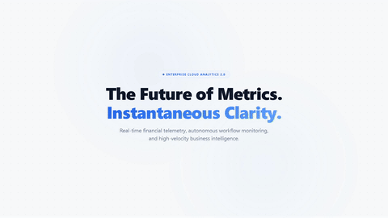
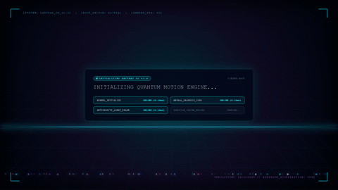
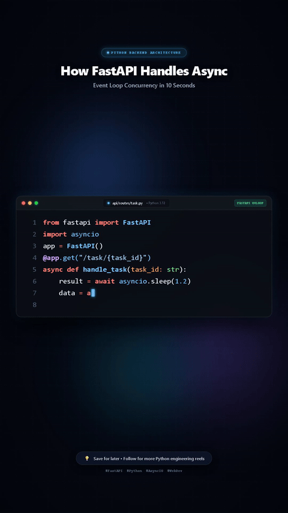

# Remotion Engine for Antigravity (REA)

<div align="center">


-00f5ff?style=for-the-badge&logo=github&logoColor=white)


<br/>

**The Autonomous Motion Graphics, Procedural Sound Synthesis, AI Voiceover & Multimedia Video Editing Engine for Google Antigravity 2.0 AI Agents.**

*Generate, animate, narrate, synthesize sound, trim, loudness-normalize, and render production-grade React videos directly from autonomous AI prompts.*

<br/>

</div>

---

## 🎬 Autonomous Production Showcases

Explore animated examples generated programmatically by Antigravity using the REA ecosystem:

<div align="center">

| 1. Flagship REA Hero Motion Showcase | 2. KeplerBridge 6-Act Technical Documentary |
| :---: | :---: |
| [](assets/rea-hero-poster.jpeg) | [](assets/keplerbridge-doc-poster.jpeg) |
| *10s @ 30fps • 1920×1080 • Kinetic typography & HUD* | *139s @ 30fps • 6-Act chunked render • Tactile grid paper* |

<br/>

| 3. Minimalist SaaS Product Launch Promo | 4. Cyberpunk Sci-Fi HUD & Telemetry |
| :---: | :---: |
| [](assets/saas-demo.gif) | [](assets/cyberpunk-demo.gif) |
| *12s @ 30fps • 1920×1080 • 3D transforms & metrics* | *10s @ 30fps • 1920×1080 • Differential SVG gyroscopes* |

<br/>

| 5. Vertical Social Short Reel (9:16) |
| :---: |
| [](assets/vertical-reel-demo.gif) |
| *10s @ 30fps • 1080×1920 • Camera zoom & terminal typing* |

</div>

---

## 📌 Executive Architecture & System Design

REA bridges programmatic React motion graphics and autonomous AI agents through a native CLI (`bin/rea-cli.js`), an isolated bundled cross-platform FFmpeg toolchain, deterministic animation curves, and memory-safe chunked rendering.

```
                      ┌──────────────────────────────────────────────────┐
                      │         Google Antigravity 2.0 AI Agent          │
                      └────────────────────────┬─────────────────────────┘
                                               │
                           Prompt: "Build a 10-minute Vox documentary"
                                               │
                                               ▼
                      ┌──────────────────────────────────────────────────┐
                      │              REA CLI Orchestrator                │
                      │                (bin/rea-cli.js)                  │
                      └────────┬───────────────┬────────────────┬────────┘
                               │               │                │
            ┌──────────────────┴┐     ┌────────┴────────┐     ┌─┴────────────────┐
            │ Remotion Engine   │     │ Lifecycle Hook  │     │  Bundled FFmpeg  │
            │   (React 18)      │     │ Pre-Render Gate │     │  (Zero-Config)   │
            └─────────┬─────────┘     └─────────────────┘     └─┬────────────────┘
                      │                                         │
        ┌─────────────┴──────────┐                ┌─────────────┴────────────────┐
        │  src/plugins/          │                │  Zero-Loss Video Trimming    │
        │  • rea-particles       │                │  EBU R128 Loudness Normal.   │
        │  • rea-transitions     │                │  Stream Telemetry Probing    │
        │  • rea-typography      │                │  High-Res Still Posters      │
        │  • rea-captions        │                │  Lossless Concat Demuxer     │
        │  • rea-mockups         │                └──────────────────────────────┘
        └─────────────┬──────────┘
                      │
        ┌─────────────┴──────────────────────────────────────────────────────────┐
        │        Audio, Voice & Memory-Safe Long-Form Pipeline                   │
        │        • Google Gemini 3.8 Flash TTS & Free Edge TTS Dual Engine       │
        │        • Turn-by-Turn Multi-Speaker Dialogue Synthesis                 │
        │        • Pure Node.js 44.1 kHz 16-Bit Mono PCM Procedural SFX          │
        │        • Vox Journalistic Editorial Guardrails & Syllable Density      │
        │        • Manifest-Driven Chunked Multi-Act Rendering (rea render-long) │
        └────────────────────────────────────────────────────────────────────────┘
```

---

## ⚡ Quick Start & Global Skill Installation

REA installs as an autonomous system skill inside Google Antigravity across Windows, macOS, and Linux:

```bash
# 1. Clone repository
git clone https://github.com/HamzaShaikhAI/Remotion-For-Antigravity.git
cd Remotion-For-Antigravity

# 2. Install dependencies (Bundles Remotion, Chromium, FFmpeg & Google GenAI SDK)
npm install

# 3. Deploy skill globally into ~/.gemini/config/skills/remotion-dastras
node bin/rea-cli.js install-skill
```

---

## 🛠️ Unified CLI Command Reference

Execute all operations via `rea <command>` (or `node bin/rea-cli.js <command>`):

### 🎙️ 1. Audio, Sound Design & Neural Voiceover

| Command | Usage | Description |
| :--- | :--- | :--- |
| **`install-skill`** | `rea install-skill` | Deploys bundled skill globally into `~/.gemini/config/skills/remotion-dastras`. |
| **`sfx`** | `rea sfx <whoosh\|pop\|riser\|typewriter> [out.wav]` | Synthesizes deterministic 44.1 kHz 16-bit PCM WAV sound effects directly into `public/sfx/` with zero external dependencies. |
| **`voice`** | `rea voice "<text>" [out.wav] [--provider=gemini\|edge] [--voice=...] [--style="..."]` | Dual-engine voiceover: broadcast Google Gemini 3.8 Flash TTS (`gemini-3.8-flash-tts`) or zero-key Edge TTS. Calculates exact Remotion frame counts. |
| **`voice (dialogue)`** | `rea voice --dialogue=script.json [out.wav] [--provider=gemini]` | Synthesizes conversational 2-person dialogues for podcasts and audiograms with turn-by-turn speaker annotations. |
| **`validate-script`** | `rea validate-script <text \| file.txt>` | Audits voiceover scripts against `rules/vox-editorial.md` for syllable density (3.8–4.5/sec) and flags cliché phrases. |

### 🎬 2. Remotion Studio & Rendering Commands

| Command | Usage | Description |
| :--- | :--- | :--- |
| **`init`** | `rea init <project-name>` | Scaffolds a new TypeScript-enabled Remotion workspace with full REA integration. |
| **`add`** | `rea add <plugin-name>` | Injects modular visual plugins (`rea-particles`, `rea-transitions`, `rea-typography`, `rea-captions`, `rea-mockups`). |
| **`preview`** | `rea preview` | Launches live interactive Remotion Studio at `http://localhost:3000`. |
| **`render`** | `rea render <comp-id> [out.mp4]` | Runs pre-flight audit and compiles high-definition video via Chromium workers. |
| **`render-long`** | `rea render-long <Comp1,Comp2..\|--auto> [out.mp4]` | Memory-safe chunked rendering for long-form videos (> 120s); flushes Chromium RAM between segments and losslessly concatenates with bundled FFmpeg. |
| **`validate`**| `rea validate [comp-id]` | Audits `src/Root.tsx`, `public/` directory, and all `staticFile()` imports. |
| **`list-plugins`** | `rea list-plugins` | Displays the catalog of available visual plugins. |
| **`hook`** | `rea hook pre-render` | Intercepts agent tool calls before render execution to prevent runtime failures. |

### ✂️ 3. Bundled Multimedia & FFmpeg Editing Commands

| Command | Usage | Description |
| :--- | :--- | :--- |
| **`cut`** | `rea cut <in.mp4> <start> <dur> [out.mp4] [--normalize]` | Slices raw video with frame-level accuracy using stream copy (zero quality loss); pass `--normalize` for EBU R128 loudness normalization (`-16 LUFS`). |
| **`probe`** | `rea probe <media-file>` | Deep telemetry inspection of video/audio streams, duration, resolution, codecs, and framerate. |
| **`audio`** | `rea audio <in.mp4> [out.mp3]` | Extracts crystal-clear MP3 audio tracks from any video container. |
| **`still`** | `rea still <comp-id> [out.jpeg] [--frame=N]` | Renders a high-resolution still frame poster at any exact timestamp. |
| **`gif`** | `rea gif <comp-id> [out.gif] [--fps=15]` | Compiles an optimized animated GIF for documentation or social sharing. |

---

## 🧠 Architectural Highlights

### 1. Dual-Provider AI Voice Engine & Multi-Speaker Dialogue
- **Google Gemini 3.8 Flash TTS (`--provider=gemini`):** Direct RIFF 24 kHz mono 16-bit PCM WAV audio streaming via `@google/genai` and model `gemini-3.8-flash-tts`. Supports delivery style annotations (`--style="..."`) and multi-speaker dialogues (`--dialogue=dialogue.json`).
- **Zero-Key Neural Edge TTS (Default Fallback):** Free, unlimited high-clarity voice synthesis with zero API keys required.

#### Curated Gemini 3.8 Flash TTS Voices
| Video Style | Voice | Recommended `--style` Flag | Vocal Character |
| :--- | :--- | :--- | :--- |
| **Vox / Documentary** | `Charon` / `Rasalgethi` | `"warm, authoritative, measured documentary narrator"` | Informative, clear, grounded |
| **Cyberpunk / Sci-Fi** | `Orus` / `Alnilam` | `"calm, futuristic, slightly resonant AI system voice"` | Firm, deep, cinematic |
| **Tech / SaaS Launch** | `Zephyr` / `Puck` | `"energetic, upbeat, modern product keynote"` | Bright, enthusiastic, crisp |
| **Storytelling / Explainer** | `Sulafat` / `Aoede` | `"warm, inviting, conversational storyteller"` | Warm, breezy, natural |

---

### 2. Pure Node.js Procedural Sound Design (`rea sfx`)
Synthesizes broadcast-quality 44.1 kHz 16-bit PCM WAV audio directly inside Node.js buffer mathematics without third-party audio binaries:

```bash
rea sfx whoosh public/sfx/whoosh.wav      # Exponential frequency sweep (200 Hz -> 800 Hz)
rea sfx pop public/sfx/pop.wav            # Sharp sine transient with parabolic decay
rea sfx riser public/sfx/riser.wav        # Tension-building frequency ramp (100 Hz -> 1200 Hz)
rea sfx typewriter public/sfx/type.wav    # Crisp 2.4 kHz terminal key transient
```

---

### 3. Chunked Segment Rendering for Long-Form Timelines (`rea render-long`)
When compositions exceed 120 seconds (`durationInFrames > 120 * fps`), single-pass Chromium rendering risks memory exhaustion.

REA enforces a **Manifest-Driven Multi-Act Architecture** in `src/Root.tsx`:
- Defines `ACTS_MANIFEST` as the single source of truth for audio-locked Act durations.
- Registers both `<Series>` (master preview) and `<Folder name="Render-Segments">` (standalone targets).
- Compiles each segment in process isolation with `--concurrency=2` into `.rea-chunks/`.
- Stitches finished segments losslessly using the bundled FFmpeg concat demuxer at 300x+ speed:

```bash
rea render-long --auto final-documentary.mp4
```

---

## 🚨 Known Issues, Roadmaps & Community Tracker

Technical issues, bug tracking, and architectural enhancement proposals are maintained directly in the repository's **GitHub Issues Tracker**:

👉 **[View All Open Issues & Architecture Proposals](https://github.com/HamzaShaikhAI/Remotion-For-Antigravity/issues)**

| Issue ID | Category | Summary |
| :---: | :--- | :--- |
| **[#1](https://github.com/HamzaShaikhAI/Remotion-For-Antigravity/issues/1)** | `Feature` | Programmatic Subtitle Burn-In via WebVTT & ASS Parsers |
| **[#2](https://github.com/HamzaShaikhAI/Remotion-For-Antigravity/issues/2)** | `Performance` | Hardware-Accelerated NVENC/AMF H.264 Video Encoding Pipeline |
| **[#3](https://github.com/HamzaShaikhAI/Remotion-For-Antigravity/issues/3)** | `Audio` | EBU R128 True Peak Limiter Implementation for Loudness Normalization |
| **[#4](https://github.com/HamzaShaikhAI/Remotion-For-Antigravity/issues/4)** | `Engine` | Chromium RAM Footprint Optimization for 10+ Minute Long-Form Timelines |
| **[#5](https://github.com/HamzaShaikhAI/Remotion-For-Antigravity/issues/5)** | `Audio` | Multi-Speaker Audio Waveform Peak Detection and Reactive Visualizer Shaders |
| **[#6](https://github.com/HamzaShaikhAI/Remotion-For-Antigravity/issues/6)** | `CLI` | Automated Voiceover Frame Locking with Dynamic Pacing Telemetry |
| **[#7](https://github.com/HamzaShaikhAI/Remotion-For-Antigravity/issues/7)** | `Plugin` | Interactive 3D Perspective Transforms for SaaS Product Mockups |
| **[#8](https://github.com/HamzaShaikhAI/Remotion-For-Antigravity/issues/8)** | `Security` | Pre-Render Hook Asset Auditing for Distributed Cloud Workers |
| **[#9](https://github.com/HamzaShaikhAI/Remotion-For-Antigravity/issues/9)** | `CI/CD` | Automated Multi-Platform Headless Rendering Benchmarks on GitHub Runners |
| **[#10](https://github.com/HamzaShaikhAI/Remotion-For-Antigravity/issues/10)** | `Documentation` | Interactive Audio-First Motion Graphics Tutorial & Starter Templates |

To report a new bug or propose a feature, [open a new issue on GitHub](https://github.com/HamzaShaikhAI/Remotion-For-Antigravity/issues/new).

---

## ❓ Frequently Asked Questions (FAQs)

#### Q1: Does REA require a discrete GPU or hardware acceleration?
**A:** No. REA compiles videos headlessly using Remotion's CPU-based SwiftShader software rasterizer. While hardware acceleration provides a speedup on systems with dedicated GPUs, REA runs reliably on standard cloud instances, GitHub Actions runners, and laptops without a discrete GPU.

#### Q2: Can I use REA completely free without paying for API keys?
**A:** Yes! REA is built around a **Zero-Key First Principle**:
- Audio voiceovers default to zero-key neural Edge TTS (`--provider=edge`).
- Sound design synthesis (`rea sfx`) runs 100% locally via pure Node.js PCM math.
- FFmpeg video cutting, probing, and rendering run locally without external APIs.
The Google Gemini 3.8 Flash TTS provider is an optional broadcast-grade enhancement.

#### Q3: What is the maximum video length REA can render?
**A:** With the chunked segment renderer (`rea render-long`), there is no technical upper limit. Long-form documentaries of 10 minutes, 30 minutes, or longer render smoothly by breaking the video into 30–90 second Acts in `src/Root.tsx`, keeping Chromium memory usage capped under 3 GB throughout the render.

#### Q4: Why does REA strictly forbid `Math.random()` in React components?
**A:** Remotion renders frames concurrently across multiple Chromium workers. If components rely on `Math.random()`, wall-clock timers (`Date.now()`), or unmanaged async state, frames flicker. REA enforces deterministic mathematical formulas where every visual coordinate, scale, and opacity is a pure mathematical function of `frame` and `fps`.

#### Q5: Can I add custom visual plugins to REA?
**A:** Absolutely. Create a new directory under `src/plugins/<my-plugin>/` containing an `index.tsx` component and an `index.ts` re-export. Once created, run `rea list-plugins` to verify registration, and import the plugin directly into your compositions.

#### Q6: How does REA handle audio loudness compliance for broadcast and social media?
**A:** Passing the `--normalize` flag to `rea cut` applies an EBU R128 two-pass loudness filter (`loudnorm=I=-16:TP=-1.5:LRA=11`). This sets the integrated loudness to `-16 LUFS` with a maximum true peak of `-1.5 dBFS`, conforming to YouTube, Spotify, and broadcast streaming standards.

#### Q7: Does REA support vertical aspect ratios (9:16) for TikTok, Reels, and Shorts?
**A:** Yes. Specify `width={1080}` and `height={1920}` in your composition in `src/Root.tsx`. REA includes dedicated responsive templates and typography plugins optimized for vertical mobile viewports.

---

## 🤝 Community, Contributing & Governance

Contributions from developers, motion designers, and AI researchers are welcome!

- **Contributing Guidelines:** Please review [CONTRIBUTING.md](CONTRIBUTING.md) for architectural guidelines, test suite verification, and PR submission standards.
- **Licensing:** Licensed under the permissive [MIT License](LICENSE) — free for personal, commercial, and enterprise applications.
- **Author:** [Hamza Shaikh](https://github.com/HamzaShaikhAI)

---

## 🌐 GEO-SEO & Global Developer Targeting

REA is engineered for seamless search and discovery across modern AI coding agents, enterprise developer search engines, and programmatic multimedia tooling:

- **Target Search Domains:** Programmatic Video Generation, AI Agent Video Direction, React Motion Graphics, Autonomous Video Post-Production, Remotion Automation, Headless FFmpeg Processing, Procedural SFX Synthesis.
- **Regional Developer Hubs:** 
  - **North America:** San Francisco, Seattle, New York, Austin, Toronto.
  - **Europe:** London, Berlin, Amsterdam, Zurich, Paris, Stockholm.
  - **Asia-Pacific:** Bengaluru, Singapore, Tokyo, Sydney, Seoul, Tel Aviv.
- **Core Integrations:** Google Antigravity 2.0, Remotion v4, Google Gemini Live / Flash, Edge TTS, FFmpeg, React 18, TypeScript.

```json
{
  "@context": "https://schema.org",
  "@type": "SoftwareApplication",
  "name": "Remotion Engine for Antigravity (REA)",
  "operatingSystem": "Cross-platform (Windows, macOS, Linux)",
  "applicationCategory": "MultimediaApplication, DeveloperApplication",
  "offers": { "@type": "Offer", "price": "0", "priceCurrency": "USD" },
  "description": "Enterprise-grade autonomous motion graphics, procedural sound synthesis, neural voiceover, and FFmpeg multimedia engine for Google Antigravity 2.0 AI agents.",
  "softwareVersion": "2.0.0-rc.1",
  "author": { "@type": "Person", "name": "Hamza Shaikh", "url": "https://github.com/HamzaShaikhAI" }
}
```
